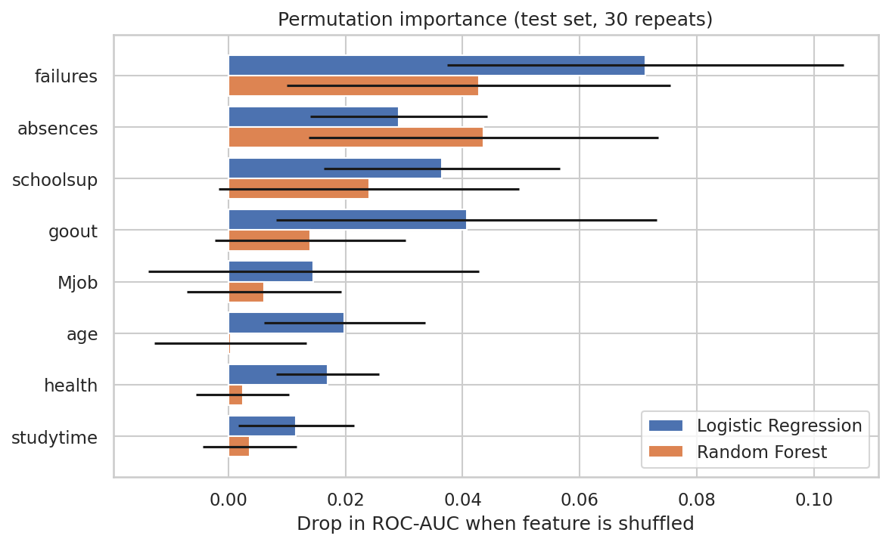
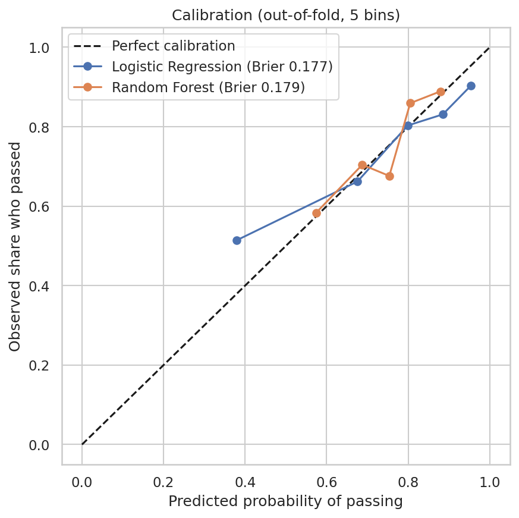

# Student Performance XAI

**What drives student math performance? An explainable machine learning study.**

This project asks: *which background and behavior factors help predict whether a student passes the final math course, and how far can we trust those predictions?*

It compares Logistic Regression and Random Forest against a majority-class baseline, evaluates them with cross-validation, and explains the results using coefficients and permutation importance. Two robustness checks test how far the conclusions can be trusted: a sensitivity analysis on how zero-grade records are handled, and a probability calibration check. The aim is to understand what the data can and cannot tell us, not to maximize accuracy.

## Key findings

- Without prior grades, background and behavior features give only **modest predictive signal** (ROC-AUC about 0.67 to 0.72). Accuracy stays close to the 0.74 baseline, and the models miss many failing students.
- **Past failures** ranked first and **school support** remained among the more important features across both analyses. These are associations, not causal effects.
- Neither model can be shown to be better than the other: the ranking changed between the single split, cross-validation, and the sensitivity analysis.

## Dataset

- **Source:** [UCI Student Performance dataset](https://archive.ics.uci.edu/dataset/320/student+performance) (Cortez and Silva, 2008), math course file `student-mat.csv`.
- **Size:** 395 students from two Portuguese secondary schools, 33 columns (demographics, family background, study habits, school support, absences, and three grades G1, G2, G3).
- **Grades:** scored 0 to 20; 10 or more is a pass.
- **Target:** `pass` = 1 if the final grade G3 is at least 10, otherwise 0.

## Data decisions

| Decision | Reason |
|---|---|
| Excluded G1 and G2 from the features | They almost determine G3 (data leakage). A model using them mostly learns "last term's grade predicts this term's grade", which does not explain what drives performance. |
| Excluded 38 students with G3 = 0 from the primary analysis | All 38 have exactly 0 recorded absences and declining earlier grades, which suggests they left the course instead of scoring zero. This is an assumption, as the data cannot confirm it. The primary analysis therefore covers the 357 students who sat the final exam. A sensitivity analysis on all 395 students tests this decision. |
| Kept all other 30 columns | 17 categorical columns are one-hot encoded and 13 numeric columns are used as they are (scaled for Logistic Regression). |

After cleaning, 265 students passed (74.2%) and 92 failed (25.8%). A model that always predicts "pass" would therefore reach 74.2% accuracy, and this is used as the baseline.

## Methods

### Prediction setup

- **Target:** `pass` = 1 if G3 >= 10, otherwise 0.
- **Features:** 30 background and behavior columns (17 categorical, 13 numeric). G1, G2 and G3 are excluded to avoid leakage.
- **Primary population:** 357 students with G3 > 0.

### Models

| Model | Preprocessing | Settings |
|---|---|---|
| Baseline | None | Always predicts "pass" (majority class) |
| Logistic Regression | One-hot encoding (first level dropped) and standardized numeric columns | `max_iter=1000` |
| Random Forest | One-hot encoding, numeric columns unchanged | 300 trees, `min_samples_leaf=3` |

Both models are scikit-learn pipelines, so encoding and scaling are learned from the training data only in every split. I chose a simple linear model and a tree ensemble to test whether a more flexible model helps on a small dataset. No hyperparameter tuning was done, to keep the comparison simple and avoid overfitting a 357-student dataset.

### Evaluation

- **Single split:** a stratified 75/25 split (267 train, 90 test), used for confusion matrices and a first look.
- **5-fold stratified cross-validation (seed 42):** the main evaluation. A 90-student test set is too small to rank models reliably, and the single split and cross-validation ranked the two models differently.
- **Metrics:** accuracy, balanced accuracy, ROC-AUC, recall for failing students, and Brier score. Because 74.2% of students pass, accuracy alone is misleading: the baseline already scores 0.742. Balanced accuracy, ROC-AUC and fail recall show whether a model separates failing students from passing ones. All cross-validation results are reported as mean +/- standard deviation across folds.

### Explainability

- **Logistic Regression coefficients**, and their stability across the 5 cross-validation folds.
- **Permutation importance** on the held-out test set (30 repeats, drop in ROC-AUC), computed for both models on the original columns, so a feature such as `Mjob` appears as one bar and not as several dummy columns.

### Robustness checks

- **Sensitivity analysis:** the same pipeline and cross-validation on all 395 students, with G3 = 0 counted as failing. Accuracy is not compared across the two populations, because the baseline changes (0.742 vs 0.671).
- **Calibration:** out-of-fold predicted probabilities, a 5-bin calibration plot, and Brier scores compared with a baseline that predicts the overall pass rate.

### Reproducibility

All random processes use `random_state=42`. The notebook runs top to bottom with no manual steps.

## Results

### 1. Model comparison (primary analysis, 357 students, 5-fold cross-validation)

| Model | Accuracy | Balanced accuracy | ROC-AUC | Fail recall |
|---|---|---|---|---|
| Baseline (always "pass") | 0.742 +/- 0.005 | 0.500 | 0.500 | 0.000 |
| Logistic Regression | 0.745 +/- 0.030 | 0.601 +/- 0.041 | 0.717 +/- 0.049 | 0.304 +/- 0.064 |
| Random Forest | 0.737 +/- 0.020 | 0.514 +/- 0.022 | 0.669 +/- 0.040 | 0.054 +/- 0.033 |

- **Accuracy is essentially at baseline level.** All three models achieve accuracy around 0.74. Logistic Regression is marginally above the baseline (0.745 vs 0.742), but this small difference, which is smaller than the spread across folds, does not demonstrate a meaningful improvement in overall classification accuracy.
- **ROC-AUC suggests modest predictive signal.** Both models achieved ROC-AUC scores above 0.5, with Logistic Regression higher in the primary analysis. However, the discrimination is limited, and neither model reliably identifies failing students at the default threshold: Logistic Regression finds about 30% of them, and Random Forest only about 5%, because it predicts "pass" for almost everyone.
- **A single split gave a different ranking.** On one 90-student test set, Random Forest looked better (accuracy 0.767, ROC-AUC 0.668) than Logistic Regression (0.733, 0.648), but cross-validation reversed this. Small test sets are unreliable for ranking models.
- The ROC-AUC difference between the models (0.717 vs 0.669) is small relative to their fold-to-fold variability. These results do not establish a clear performance advantage for either model, and no formal statistical comparison was performed.

### 2. Which features matter?



*Permutation importance on the 90-student test set (30 repeats). Error bars show the standard deviation across shuffles. They are not formal confidence intervals and do not include the uncertainty that comes from the small test set, so the true uncertainty is larger.*

| Feature | Logistic Regression | Random Forest |
|---|---|---|
| `failures` | 0.071 +/- 0.034 | 0.043 +/- 0.033 |
| `absences` | 0.029 +/- 0.015 | 0.044 +/- 0.030 |
| `schoolsup` | 0.036 +/- 0.020 | 0.024 +/- 0.026 |
| `goout` | 0.041 +/- 0.032 | 0.014 +/- 0.016 |

*Mean drop in ROC-AUC (+/- standard deviation across shuffles) when the feature is shuffled.*

- `failures` and `absences` have positive mean permutation importance in both models. Their mean-minus-one-standard-deviation values remain above zero (for `failures` in Random Forest only barely: 0.043 - 0.033 = 0.010), although this is descriptive evidence rather than a formal statistical test. `schoolsup` and `goout` show less consistent importance, particularly for Random Forest, where their error bars include zero. Features lower in the plot (`Mjob`, `age`, `health`, `studytime`) show weak or uncertain evidence of importance.
- **Logistic Regression coefficients** were extracted in each of the 5 cross-validation folds. The ten coefficients with the largest absolute fold-averaged value kept the same sign in all 5 folds. `schoolsup` was the most stable (mean -1.19, std 0.07). Other stable negative coefficients include `goout`, `famsup`, `absences` and `failures`. Some coefficients vary a lot between folds (for example `nursery`, std 0.28 against a mean of -0.48), and a few have no obvious explanation (`Mjob_teacher` negative, `Fjob_teacher` positive), which may be noise from small groups. Because numeric features are standardized and categorical features are one-hot encoded, coefficient magnitudes are not directly comparable across all features, so the focus here is on signs and stability.
- **`schoolsup` is negative, but this is unlikely to mean that support harms students.** Extra support is usually given to students who already struggle, so it marks difficulty rather than causing it. The same reasoning applies to `famsup`.
- The five cross-validation training sets overlap substantially, so consistent coefficient signs indicate stability within this dataset rather than independent confirmation that the associations generalize to other students.

### 3. Sensitivity analysis: keeping the 38 zero-grade students

Same pipeline and cross-validation, all 395 students, G3 = 0 counted as failing. The baseline accuracy changes (0.742 to 0.671), so accuracy is not compared across the two populations.

| Model | Balanced accuracy | ROC-AUC | Fail recall |
|---|---|---|---|
| Logistic Regression, primary (n=357) | 0.601 +/- 0.041 | 0.717 +/- 0.049 | 0.304 +/- 0.064 |
| Logistic Regression, all (n=395) | 0.609 +/- 0.055 | 0.682 +/- 0.048 | 0.369 +/- 0.079 |
| Random Forest, primary (n=357) | 0.514 +/- 0.022 | 0.669 +/- 0.040 | 0.054 +/- 0.033 |
| Random Forest, all (n=395) | 0.579 +/- 0.016 | 0.702 +/- 0.048 | 0.223 +/- 0.029 |

- **The overall conclusion of limited predictive performance remains similar.** On both populations the ROC-AUC is about 0.67 to 0.72, but the individual numbers change: Logistic Regression's ROC-AUC falls while Random Forest's rises, and fail recall increases for both.
- **The model ranking changes between the two populations**, and the cross-validation results do not provide strong evidence that either model consistently outperforms the other.
- **Random Forest gains the most from the extra fail cases.** Failing students make up 32.9% of the data instead of 25.8%, so the forest predicts "fail" more often at the default 0.5 threshold.
- **Feature importance** was recomputed on all 395 students with a single 75/25 split (99 test students), so it is noisier than the primary analysis. Rankings use the same method in both analyses (average of the Logistic Regression and Random Forest permutation importance), but on different test splits (90 vs 99 students). `failures` ranks first and `schoolsup` is in the top three in both analyses. `absences` (rank 2 in the primary analysis, rank 5 here) and `goout` (rank 4, then rank 8) lose importance when the zero-grade students are kept. A possible explanation is that these students all have 0 recorded absences but are counted as failing, which weakens the usual link between absences and failing. This is a hypothesis and was not tested. Features below the top three have importance close to zero and their rank changes between analyses, so they should not be interpreted.

### 4. Probability calibration



*Out-of-fold predicted probabilities, 5 bins.*

| Model | Brier score (lower is better) |
|---|---|
| Baseline (predicts 0.742 for everyone) | 0.191 |
| Logistic Regression | 0.177 |
| Random Forest | 0.179 |

Both models have a lower Brier score than the baseline, but the improvement is modest, with Logistic Regression marginally better. The Brier score combines calibration and discrimination, so it is not a pure calibration measure. The calibration curves are reasonably close to the diagonal in several bins, but deviations remain (for example, in the plot, Logistic Regression's lowest-probability bin has an observed pass rate of about 0.5, higher than its predicted value of about 0.4). With only 357 students, each bin holds about 70 students, so the curves are approximate. The probabilities carry some useful information but should not be treated as reliable individual-level estimates.

### Summary

Without prior grades, background and behavior features provide modest predictive signal (ROC-AUC about 0.67 to 0.72), while accuracy remains close to the baseline. Past failures ranked first and school support remained among the more important features across both analyses. Absences and going out showed predictive value in the primary analysis, but their importance was sensitive to how zero-grade records were handled. These findings describe associations, not causal effects.

## Limitations

- **Association, not causation.** Features such as `schoolsup` may reflect existing academic difficulties rather than cause them.
- **Small, narrow dataset.** The primary analysis covers 357 students from two schools and one subject, limiting generalizability. Performance estimates are uncertain, and the 90-student test set is relatively small.
- **Weak predictive signal.** Without prior grades, discrimination is modest, and accuracy alone is misleading given the class imbalance. At the default 0.5 threshold, both models identify failing students poorly; alternative thresholds were not evaluated.
- **Zero-grade ambiguity.** Students with `G3 = 0` were excluded from the primary analysis based on the assumption that they did not complete the course. This could not be confirmed, so a sensitivity analysis including all 395 students was conducted. Conclusions about `absences` and `goout` vary depending on how these records are handled.
- **Uncertain explanations.** Feature importance varies across models, splits, and populations. Permutation importance can be unreliable when features are correlated, and the error bars shown reflect variation across permutations rather than all sources of uncertainty.
- **Sensitive features.** The dataset includes features such as `sex` and parental education. This project does not assess fairness, and the models should not be used to make decisions about individual students.
- **No formal model comparison.** Differences between models were interpreted descriptively, considering fold-to-fold variability rather than using formal statistical tests.

## How to run

**Repository structure**

```
student-performance-xai/
├── README.md
├── student_performance_xai.ipynb
├── importance.png
├── calibration.png
├── requirements.txt
└── data/
    └── student-mat.csv
```

**Steps**

1. Download `student-mat.csv` from the [UCI page](https://archive.ics.uci.edu/dataset/320/student+performance) (the file is inside the `student.zip` archive) and place it in `data/`.
2. Install the dependencies: `pip install -r requirements.txt`
3. Open `student_performance_xai.ipynb` in Jupyter or Google Colab and run all cells from top to bottom. The notebook reads the data with `pd.read_csv("data/student-mat.csv", sep=";")`; if you run it in Colab, upload the CSV and adjust the path.

The notebook saves `importance.png` and `calibration.png` when it runs.

## Future work

- Tune the decision threshold or use class weights, and report the trade-off between failing-student recall and false alarms.
- Add SHAP values to complement permutation importance.
- Run an "early warning" scenario that adds G1 (and then G1 and G2) as features, to show how much performance rises when earlier grades are available.
- Analyze which students receive a G3 of 0 as a separate question.
- Repeat the analysis on the Portuguese-language course file in the same UCI dataset, and use repeated cross-validation for more stable estimates.

## Reference

Cortez, P., and Silva, A. (2008). Using Data Mining to Predict Secondary School Student Performance. In *Proceedings of the 5th Future Business Technology Conference (FUBUTEC 2008)*, pp. 5-12, Porto, Portugal.

## Author

Neha Arooj — [GitHub](https://github.com/nehanasem)
